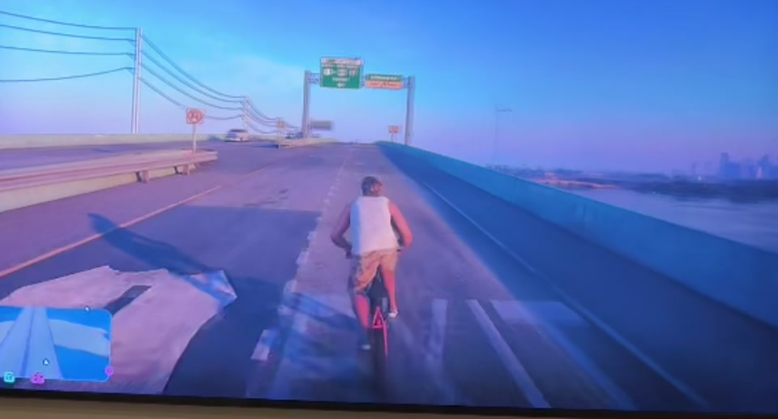
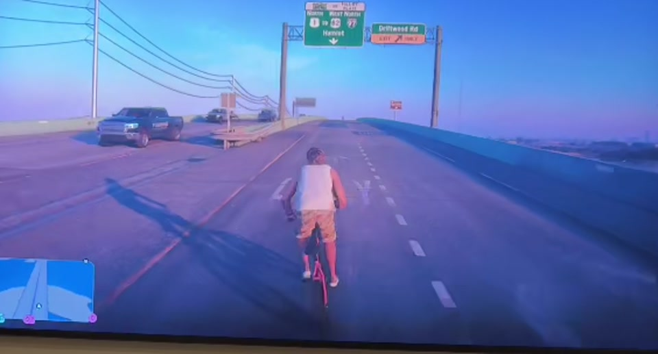
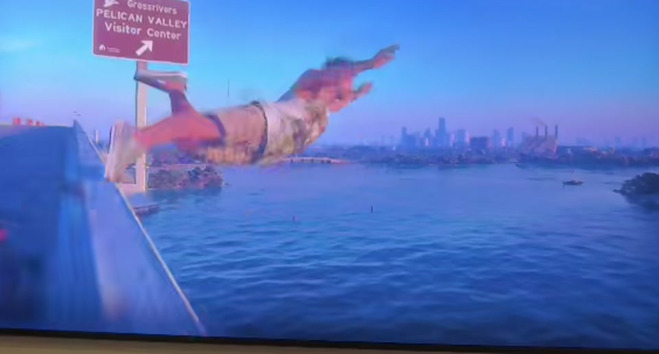
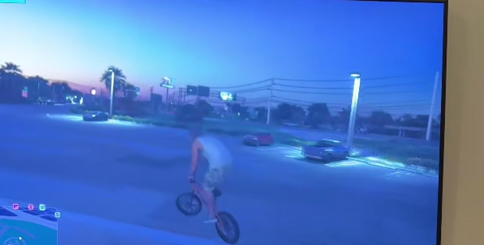
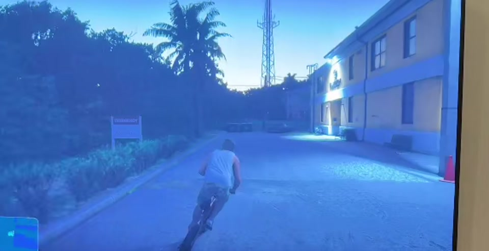
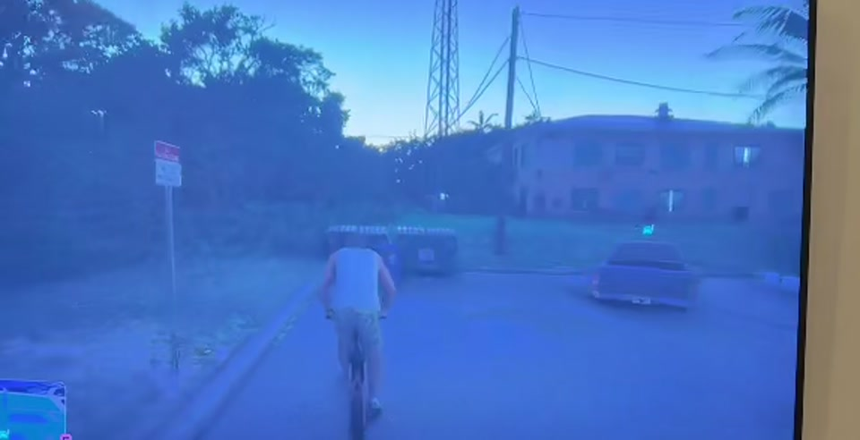
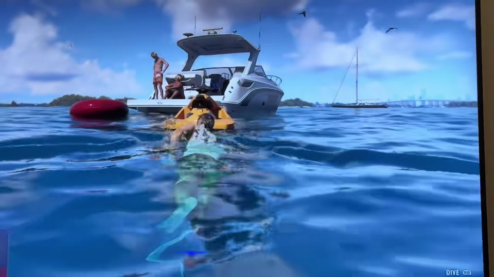

# NEON TASKING — Bunny Hop: match the real game look — the visual world

Cherie's words for this whole pass: **"How do we get this to look like the real game videos I sent."** She sent three phone videos of GTA VI bike riding (the morning Bunny Hop was commissioned) and wants the game to look like them. Your lane of that: **everything the camera looks at** — light, sky, materials, water, detail density, grade. Opus owns how the bike, rider, and camera move, in a parallel brief — don't do his job, and he won't do yours.

Live game: https://bparlette.github.io/Hawk2/games/bunny-hop/

Your original world brief (`tasking/neon.md` — the place, the data contract, the performance rules) still stands in full. This is the **look pass** on top of it: the world currently in the live build is Moth's placeholder `buildWorld.js`. Yours replaces it — same contract, same place, but it has to survive comparison with the frames below.

## The reference frames — study these first

Extracted from Cherie's videos. They are phone photos of a TV, so judge light, colour, and composition — not pixel sharpness.

*frame-1 — Sky and light: cyan overhead melting to a pink band at the horizon, haze in the distance, shadows thrown toward camera.*

*frame-2 — Asphalt: grey-blue, patchy wear, faded dashes — and shadows several metres long. This is the road material target.*

*frame-3 — Water from the bridge: rippled, sky-reflecting, sparkling — with a hazed-out skyline behind it.*

*frame-4 — Blue-hour street: streetlight pools streaking on a slight road sheen, lit signs, palms.*

*frame-5 — A building's entrance light pooling on the asphalt; hedge row and a palm in silhouette against the sky.*

*frame-6 — Everyday density: dumpster, parked sedan, one lit window, a transmission tower and sagging wires. Something every few metres.*

*frame-7 — Water at eye level: layered ripple, sky colour reflected in the surface. (Our scene is dusk — the surface behaviour is the target, not the hour.)*

## What the frames say (your evidence — argue with it or from it)

- **The light is bright dusk, not night.** Sun just at the horizon: shadows run several metres long (frame-2), highlights carry a warm pink, and the ambient is blue *sky* light — shadowed faces stay clearly readable (frames 5/6). **Nothing in any frame is near-black.**
- **The sky does the grading.** Cyan overhead → pale pink at the horizon (frame-1), and haze eats everything far away (the frame-3 skyline is a silhouette in fog).
- **Asphalt is a material, not a colour.** Mid grey-blue with patchy wear, repair strips, faded paint — and in frame-4 a slight sheen that streaks the streetlights.
- **Water is a surface.** Small ripple detail everywhere, sky colour reflected back, a sparkle path under the sun (frames 3/7). It is never a flat fill.
- **Density is the realism.** Poles with sagging catenary wires, gantry and road signs, guardrails, hedges, palms, a dumpster, parked cars, one lit window in a dark facade — the eye always has a next thing (frame-6).
- **The grade:** saturated cyan-blue shadows, warm-pink highlights, gentle atmospheric fade with distance.

## What our build does instead (measured, not vibes)

The placeholder world in the live build, from its own screenshots (local workspace, `shots-v3/`):

- **Too dark by an hour.** `water-spawn-view.png` is mostly black-blue murk with two lamp-glow sprites floating in it. Our dusk is deep night; the reference dusk is bright. Hemisphere 0.85 + ambient 0.5 under a low sun leaves everything starved.
- **Buildings are black slabs.** Flat `MeshStandardMaterial` colours and a canvas window grid; in `1-lean.png` the building behind the rider is almost pure black with grey rectangles. No facade variation, no lit-window warmth.
- **Roads are flat ribbons.** One dark colour end to end (`water-overhead.png`) — no wear, no patches, markings worn to nothing.
- **The canal is a blue carpet.** One flat colour (0x2f7fb8) + emissive + eight static pale streak decals (`water-bridge-down.png`). Compare frame-3: ripple, reflection, sparkle.
- **No street furniture.** No power lines, no signs, no hedges. The sky gradient (a canvas texture) is the one thing pointing the right way — and the scene lighting doesn't match it.

## The work

1. **Lighting model.** Sun elevation/azimuth to match the frames (low, warm-pink key, shadows long), and the sky-ambient balance lifted until shadows stay blue and readable — kill the near-blacks. Shadow quality: map size / radius / a tighter shadow frustum — propose numbers; the host already moves the sun target with the player. Fog colour and density matched to the horizon haze in frame-1/frame-3.
2. **Sky.** Gradient matched to the frames (cyan → pink band at the horizon), plus a soft sun glow near the horizon if it earns its place.
3. **Materials.** Asphalt as a canvas texture: base variation, patches, repair strips, cracks, worn dashes — plus roughness variation so streetlights sheen on it like frame-4. Concrete for sidewalks/quay. Facades with varied tone and sparse warm lit windows (emissive), not a uniform grid.
4. **Water.** A living surface inside the cheap rules: canvas ripple texture with a slow offset animation (texture-offset only, as your original brief allows), sky-reflective tint, a moving sparkle streak under the sun. Data contract unchanged — same level, same rect.
5. **Density pass.** Poles with sagging wires along the streets, bridge guardrail + a road sign or two, hedge rows, palms with silhouette fronds, the dumpster at the bin line, more parked cars — all procedural, all inside the draw-call budget.
6. **Colour grade.** Renderer tone-mapping/exposure values, specced in your report for Moth to set (the renderer is host-owned): ACES + exposure as your starting proposal, fog and sky adjusted to sit inside the same grade.

## Deliverables & boundaries

- `src/world/buildWorld.js` + `src/world/world-preview.html` — **only** `src/world/` files. The preview page must show the new look: bridge looking down the canal, and a street view at the new light.
- **Data contract is fixed** (colliders / surfaces / water / climbOut / spawn, from your original brief) — physics and gameplay code against it, and **what you see is still what you hit**: every new visible prop that can be struck goes in `colliders`, every landable top in `surfaces`. Decorative-only items stay obviously non-interactive.
- **Performance:** reuse and merge as before; state the actual draw-call count in your report and keep the world **under 150 draw calls** total. No per-frame allocations; water animation via texture offset only. No external assets — procedural canvas textures are fine.

## Acceptance

Moth reviews from your preview page, then captures side-by-sides at phone size (390×844): your street against **frame-5** (blue-hour street, light pool, silhouettes) and your canal from the bridge against **frame-3** (rippled reflective water, haze). If the water still reads as a carpet or the buildings as black slabs, it's not done. Report the draw-call count and your own preview screenshots — the audit measures the build itself, not the numbers, same as before.
