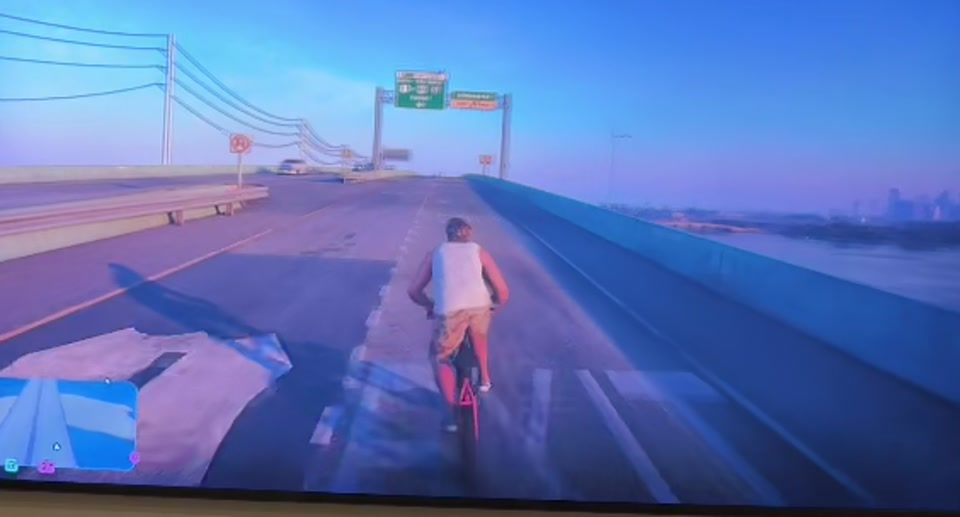
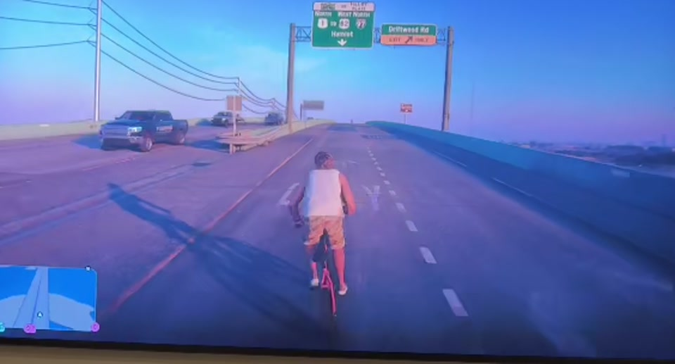
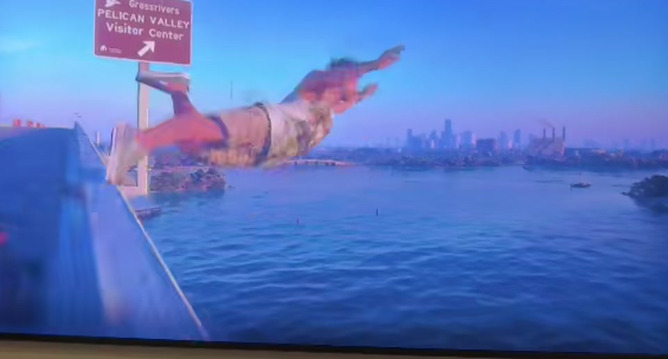
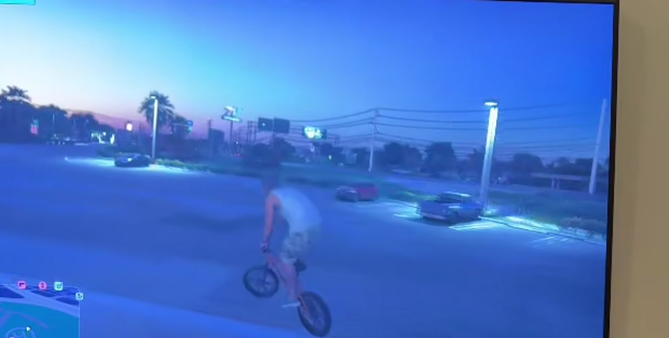
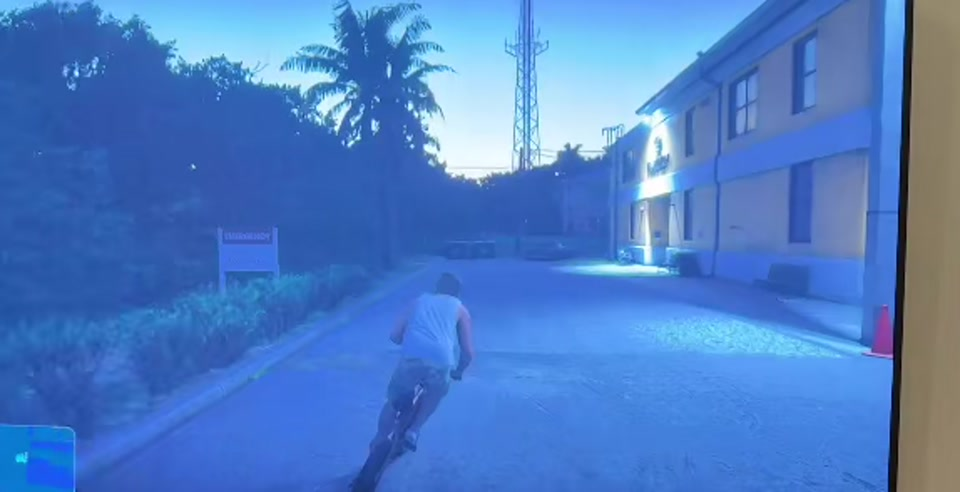
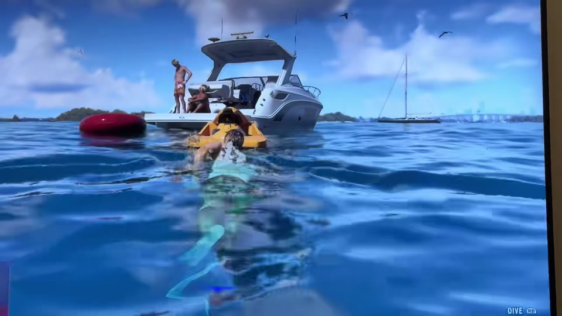

# OPUS TASKING — Bunny Hop: match the real game look — movement & camera

Cherie's words for this whole pass: **"How do we get this to look like the real game videos I sent."** She sent three phone videos of GTA VI bike riding (the morning Bunny Hop was commissioned) and wants the game to look like them. Your lane of that: **how the bike, the rider, and the camera move.** Neon owns what the camera looks *at* (light, materials, world detail) in a parallel brief — don't do her job, and she won't do yours.

Live game (your physics is already integrated — this pass builds on it): https://bparlette.github.io/Hawk2/games/bunny-hop/

## The reference frames — study these first

Extracted from Cherie's videos. They are phone photos of a TV, so judge composition, light, and motion — not pixel sharpness.

*frame-1 — Causeway chase: note how big the rider is in frame, how low the camera sits, horizon near the top.*

*frame-2 — Same road: the rider's shadow thrown metres ahead on the asphalt, and the pedalling posture.*

*frame-3 — The bail: rider leaves the bike and goes flat/horizontal over the water. This is what leaving the bike looks like.*

*frame-4 — Junction turn: wider framing mid-turn, rider small, world swinging around him.*

*frame-5 — The lean: bike and rider roll into the turn as one unit — and the horizon stays dead level.*

*frame-7 — Swimming: the camera sits at the water surface, looking slightly up at the world.*

## What the frames say (your evidence — argue with it or from it)

- **The camera is close and low.** In frame-1/frame-2, rider + bike (≈1.7 m together) fill roughly a third of the frame height. The camera reads ~3–4 m behind the rear wheel and ~1.5 m off the ground — about rider hip height — with the horizon in the top quarter of the frame. You feel *behind* the rider, not above him.
- **The camera does not inherit the lean.** Frame-5: the machine rolls hard into the turn while the horizon stays level. Only bike + rider roll; the camera yaws and follows but keeps its own up.
- **The contact shadow sells the speed.** Frame-2: the low sun behind the camera throws the rider's shadow long ahead of him on the asphalt. The bike is grounded by that shadow more than by any detail on the bike.
- **Posture is a real body.** Frames 1/2/6: torso hinged slightly forward, arms soft-bent, legs driving the cranks; at cruise the rider sits taller and relaxed. The body works — hips shift, weight moves. Nothing is a statue on a moving bike.
- **A bail is a separation.** Frame-3: rider and bike part company; the body flies flat, limbs trailing. The bike is gone from under him.
- **Swim camera is at the surface.** Frame-7: camera half in the scene at water level, swimmer's head and shoulders breaking the surface, world slightly above eye line.

## What our build does instead (measured, not vibes)

- **Camera** (`index.html`): FOV 62°, fixed **5.7 m** behind the bike, **+2.4 m** above a target 0.9 m over the bike — higher and farther than every reference frame; the rider fills ~a quarter of the frame height (`shots-v3/1-lean.png` in the local workspace). One exponential lerp (rate 4.5/s) drives all axes identically: same distance at 14 km/h as at top speed, no FOV response, no difference between straight-line follow and turn follow.
- **Rider**: boxes. The torso is a single box pre-leaned 0.36 rad *forever* — same hinge pedalling, coasting, and airborne. Arms are static bent tubes. Legs pedal (hip/shin boxes driven by a pedal phase) but the hips never rock and the weight never shifts fore/aft. Crouch = the whole rider rig sinks 0.17 m (`shots-v3/2-hop-over-bin.png`). In the air he keeps pedalling. On a bail he stays glued to the bike — frame-3 is impossible in our build.
- **Bike**: no suspension. Nothing compresses on landing; the hop reads as the whole group translating upward (`shots-v3/4-bridge-air.png`). Your physics pitch (front-first lift) exists, but check what the render pivots around — the arc doesn't read as a wheelie-pop.
- **Speed feel**: besides the HUD number, nothing in the frame says *fast* — no FOV breathe, no camera drop or lag change, no vibration. At 43 km/h the shot is identical to 14 km/h, just translating.

## The work

1. **Camera model.** Propose and implement the numbers from the frames: follow distance and height (and how each breathes with speed), FOV base + any speed term, follow lag *per axis* (position vs heading separately — the reference camera is lazy in yaw, tight in height), lookAt offset, and the roll rule (level horizon; at most a small fraction of bike lean — argue it from frame-5). Swim camera to surface height per frame-7. All of it in CONFIG-style numbers with one line of frame evidence per number.
2. **Rider animation.** A pose driver fed by bike state: pedal cycle (crank-synced legs, slight hip rock, torso bob at cadence), coast pose (taller, relaxed — frame-6), crouch (hips back and down, torso flattens toward the bars — *not* a whole-rig sink), airborne pose (cranks level, legs still, body over the rear wheel, arms pulling the bars through the pop), landing brace, and the **bail: rider separates** — spec (or implement) a simple ballistic + tumble for the rider independent of the bike, per frame-3.
3. **Bike behaviour visuals.** Fork/shock compression on landing scaled to impact velocity; hop readability — the render pitch should pivot so the front-first lift reads (rear contact point, not the centre). Wheel spin is already speed-tied; say if anything more is needed.
4. **Motion feel.** Speed sensation in CONFIG terms: FOV kick range, camera height/drop at speed, and whether any micro-vibration earns its place (amplitude/frequency, and when it must be *zero* — e.g. airborne). Argue each from the frames or from feel; tasteful beats busy. Road-surface flow cues are Neon's lane, not yours.

## Deliverables & boundaries

- Your analysis + the code. Shape is your call, like the physics module: extend `src/physics/` CONFIG/NOTES where a number belongs to physics feel, and/or add one separable pure-ESM module (e.g. `src/camera/chaseCam.js` + a rider pose driver) — justify the split in your notes. Tests (`node --test`) for any module math where they make sense: camera step response and settle, pose outputs at given states.
- Files you may touch: `src/physics/*`, `src/camera/*` (new), your NOTES. **Not** `src/world/*`, **not** the swim state machine. `index.html` integration is Moth's — write the exact seam you need (function signatures, state fields) in your notes and Moth wires it.
- Keep every number in one exported CONFIG per module, each with its frame evidence on one line.

## Acceptance

Moth integrates, then captures side-by-sides at the **same framing as frame-1** (bridge deck, riding away from camera) and **frame-5** (leaning turn), at 390×844 and judged **at phone size**: rider's share of the frame, horizon height, lean readability, posture. If the pair doesn't read as the same game family as the frames, it's not done — expect one round-trip, same as physics.
