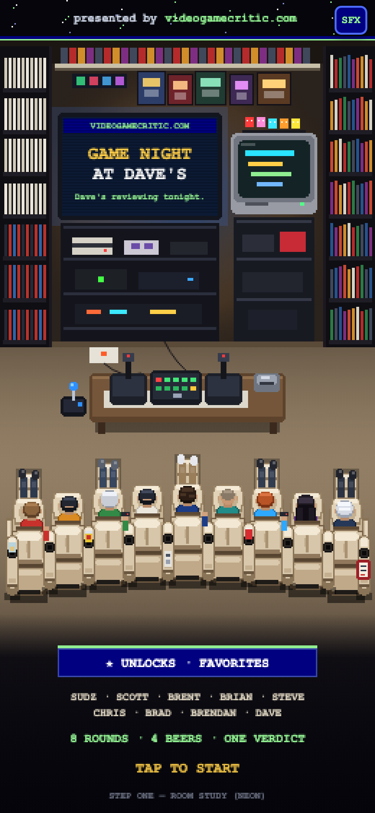
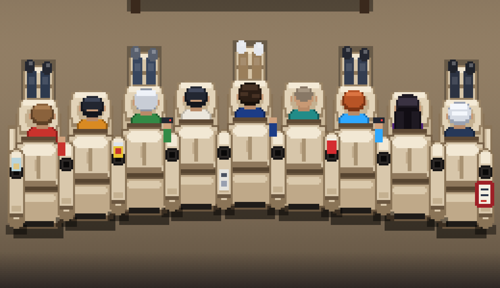

# GAME NIGHT AT DAVE'S — Step One Room Study (Neon)

**Standalone page:** `games/game-night-at-daves/neon-room/index.html`  
**Live URL:** https://bparlette.github.io/Hawk2/games/game-night-at-daves/neon-room/

## 1. Full Title View (`390×844` Phone Viewport)

## 2. Close-Up of the Recliner Row

## 3. What Changed & Why the Chairs Read as Recliners Now

1. **Sculpted 3-tier cushions instead of flat boxes:** Each of the 9 seats is rebuilt with a rounded pillow headrest bolster (with a shaded concave indent), a bulging tufted lumbar cushion separated by a deep horizontal leather seam, and an angled reclined lower base over dark floor shadows — arranged in a gentle curved theater arc so the row has real depth rather than a flat slab.
2. **Sitters sunk into the leather:** Every crew member's back-of-head nestles down into the pillow headrest with their shoulders tucked below the chair-back rim (backs of heads only, zero faces, exact left-to-right order Sudz · Scott · Brent · Brian · Steve · Chris · Brad · Brendan · Dave, with Steve's dark-brown wave/deep-navy clearly distinct from Brad's auburn crop/bright-blue).
3. **Connected extended footrests:** Five seats are kicked back with padded leather footrests extending directly out of the front of the chair cushions, complete with stretched-out pants and socked feet resting on the ottomans just like Cherie's room photos.
4. **Wide console armrests with cup holders & real props:** Padded armrests between every seat carry recessed black cup-holder rings holding a glass, yellow beer can, white TV remote, red Solo cup, and Dave's red grade book on the right-end armrest.
5. **True room layout from the photos:** The Steel Battalion dual-stick rig, grey helmet, and blue ball-top arcade stick now sit on the coffee table *in front* of the recliners between the crew and the TVs, framed by the white-spine left shelf wall, colorful retro-box right shelf wall, PlayStation light, poster collage, and the big TV (`GAME NIGHT AT DAVE'S`) beside the silver CRT topped with the Pac-Man & ghosts lamp.

## Verification
- Captured directly from `games/game-night-at-daves/neon-room/index.html` in headless Chrome at `390×844` (`deviceScaleFactor: 2`, mobile emulation) with **`0` console errors** and **`0` page errors**.
- Verified `TAP TO START` touch/click acknowledgement, `SFX` mute toggle (`z-index: 1200`), and iOS WebAudio unlock chain; `games/game-night-at-daves/index.html` was not modified.
