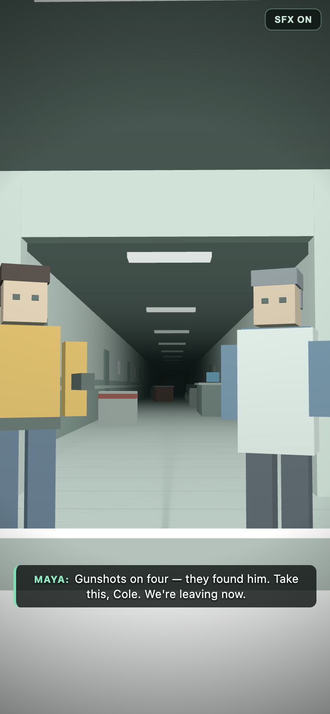
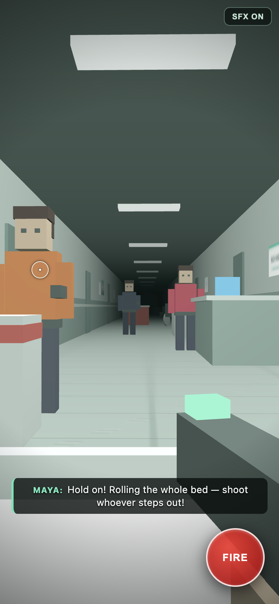
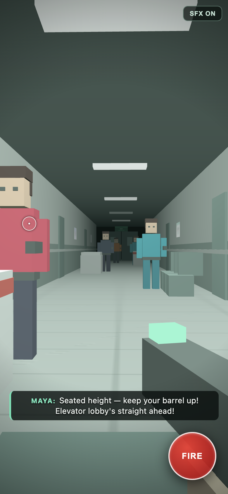

# HOSPITAL ESCAPE — Neon Step One Response

**Deliverable:** `games/hospital-escape/index.html`  
**Live URL:** https://bparlette.github.io/Hawk2/games/hospital-escape/  
**Exact file size:** `61,520` bytes (`wc -c games/hospital-escape/index.html`)

---

## Beat-by-Beat Summary (Step One Scope)

1. **Beat 1 — The Visit (Room 412, St. Mercer Memorial):** Opens in Cole Mercer's dim fluorescent hospital room (night window, IV pole, ECG monitor with periodic vitals beep, rolling bed). Maya Vance enters while floor supervisor Dr. Hale objects to discharge; distant gunshots hit Ward 4B and Maya hands Cole a pistol to break out.
2. **Beat 2 — Wheel the Bed (West Wing Hall, Rail Shoot #1):** Maya wheels the entire rolling hospital bed down the fluorescent corridor (handrails, room doors, flickering ceiling fixtures, wall posters, nurses' station, medical carts). Camera stays locked at bed height (~0.96 m) over the footboard while Cole aims and shoots 4 plain-clothes ambushers peeking from cover.
3. **Beat 3 — Transfer to the Wheelchair (Transfer Alcove):** An angled red crash cart blocks the wide bed near the West Wing directory board; camera performs a tight staged swap as Maya hauls Cole into a waiting hospital wheelchair.
4. **Beat 4 — First Wheelchair Corridor Fight (East Wing Corridor, Rail Shoot #2):** Seated-height rail camera (~1.05 m) framed by wheelchair armrests as Maya pushes Cole down the East Wing past waiting chairs, carts, and gurneys through 5 mixed plain-clothes and teal-scrubs hostiles, ending cleanly as the Elevator Lobby double doors slam shut behind them (`DOORS HELD`).

---

## Requirement Checklist (One Line Each)

- **Single file:** All HTML, CSS, Three.js scene/gameplay logic, procedural CanvasTextures, and WebAudio SFX live in one self-contained file at `games/hospital-escape/index.html` (`61,520` bytes).
- **three.js from pinned CDN (never inlined):** Loaded exclusively via `` with zero other external runtime requests.
- **`window.__dbg` hook present:** Exposes `beat`, `segment`, `hp`, `ammo`, `magSize`, `enemiesAlive`, `enemiesTotal`, `kills`, `railZ`, `reticle`, `start()`, `jumpToBeat(n)`, `aimAt(nx, ny)`, `aimAtNearestEnemy()`, `fire()`, `reload()`, `setHp(v)`, and `step(frames)`.
- **Rail camera (aim + shoot only):** During Beats 2 and 4 the camera moves along a scripted corridor path at bed/seated height; the player never steers or moves and only aims and fires.
- **Drag-aim + big FIRE button (`z-index ≥ 1100`):** Dragging anywhere moves the thin-circle reticle (with red ✕ hitmarker on hits); a round bottom-right `FIRE` button sits at `z-index: 1200`, and a contextual `RELOAD` button (`z-index: 1200`) appears only when `ammo <= 3` or reloading.
- **iOS audio unlock chain:** Sets `navigator.audioSession.type = 'playback'`, runs a silent-buffer unlock on first gesture, and resumes `AudioContext` on every `pointerdown`, `touchend`, and `visibilitychange`.
- **Double-tap zoom blocked:** Enforced via `viewport` meta (`maximum-scale=1.0, user-scalable=no`), `touch-action: none`, `overscroll-behavior: none`, and `user-select: none`.
- **Originals only:** New original characters **Cole Mercer** (wounded patient), **Maya Vance** (friend/pusher), and **Dr. Hale** in fictional **St. Mercer Memorial (Ward 4B)**; zero GTA names, assets, minimap, wanted stars, or GTA HUD styling.
- **9-beat roadmap stubbed in the file:** Top-of-script roadmap comment block documents all 9 beats and segment types (`cutscene` / `rail` / `free` / `holdout` / `chase`) while building only the Step One opening.

---

## Verification & Honest `390×844` Captures

Verified in headless Chrome (`390×844`, `deviceScaleFactor: 2`, mobile emulation) with **`0` console errors** and **`0` page errors**; live firing confirmed `ammo: 12 → 11` and red ✕ hitmarker (`hitClass: true`).

### Beat 1 — Room 412 Visit (`390×844`)

### Beat 2 — Bed Push Mid-Hall (`390×844`)

### Beat 4 — Wheelchair Corridor Fight (`390×844`)

